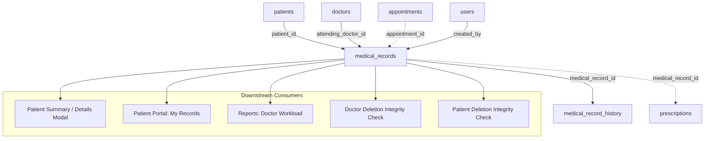

# PrimeCare — Phase 5.7.1: EHR / Medical Records Backend Readiness Audit

**Project:** PrimeCare Hospital Information and Patient Management System (`C:\xampp\htdocs\PrimeCare_v1`)  
**Database:** `primecare_db` (MariaDB 10.4.32 / InnoDB on XAMPP)  
**Audit Phase:** Phase 5.7.1 — EHR / Medical Records Backend Readiness Audit  
**Status:** Audit Completed — Ready for Implementation (0 Blockers)

---

## 1. Executive Summary

This audit assesses the readiness of the **Electronic Health Records (EHR) / Medical Records** module for migration from `localStorage` simulation to a persistent, relational PHP/MariaDB backend.

### Key Audit Findings
1. **Database Schema is 100% Pre-Constructed and Ready:**
   - The relational tables [`medical_records`](file:///c:/xampp/htdocs/PrimeCare_v1/database/primecare.sql#L408-L432) and [`medical_record_history`](file:///c:/xampp/htdocs/PrimeCare_v1/database/primecare.sql#L434-L443) are already active in `primecare_db`.
   - Seeded baseline record `M-001` (`P-001`, `D-001`, `A-001`, `Blurry vision`, `Myopia`) exists and is intact in MariaDB.
   - The sequence generator key `medicalRecords` exists in `sequences` (`prefix = 'M'`, `current_val = 1`, `pad_length = 3`), matching the global ID generator [`allocateNextId()`](file:///c:/xampp/htdocs/PrimeCare_v1/api/helpers/patients.php#L133-L179).
2. **Clinical Workflow Separation is Already Architected:**
   - **Clinical Diagnoses & Treatment Plans:** Authored exclusively by `doctor` and `admin` roles via `#record-modal`.
   - **Vital Signs Collection:** Can be authored by `nurse`, `doctor`, or `admin` via `#vitals-modal`. Vitals update the latest record created on the current date, or automatically create a designated `"Vitals check"` encounter if no record exists for the patient today.
   - **Revision History:** All updates to diagnoses or vitals automatically append audit trail entries to `medical_record_history` with timestamps, author attribution, and change summaries.
3. **No Database Schema Alterations Required:**
   - All frontend fields (chief complaint, diagnosis, treatment notes, follow-up date, attending doctor, vital signs, appointment linkage) map directly to database columns.
   - No table migrations, column additions, or destructive DDL changes are needed.
4. **Readiness Verdict:**
   - **READY FOR IMPLEMENTATION.** Phase 5.7.2 can proceed with zero schema modifications.

---

## 2. Verified Database Schema

Inspection of `primecare_db` via MariaDB CLI and [`database/primecare.sql`](file:///c:/xampp/htdocs/PrimeCare_v1/database/primecare.sql) confirms the following schema:

### 2.1 Table: `medical_records`
```sql
CREATE TABLE `medical_records` (
  `id` varchar(20) NOT NULL,
  `patient_id` varchar(20) NOT NULL,
  `appointment_id` varchar(20) DEFAULT NULL,
  `attending_doctor_id` varchar(20) DEFAULT NULL,
  `chief_complaint` text NOT NULL,
  `vital_bp` varchar(20) DEFAULT NULL,
  `vital_heart_rate` int(11) DEFAULT NULL,
  `vital_temperature` decimal(4,1) DEFAULT NULL,
  `vital_resp_rate` int(11) DEFAULT NULL,
  `vital_weight_kg` decimal(5,2) DEFAULT NULL,
  `vital_height_cm` decimal(5,2) DEFAULT NULL,
  `vital_spo2` int(11) DEFAULT NULL,
  `diagnosis` text DEFAULT NULL,
  `treatment_notes` text DEFAULT NULL,
  `follow_up_date` date DEFAULT NULL,
  `created_by` varchar(20) DEFAULT NULL,
  `created_at` datetime NOT NULL,
  `updated_at` datetime NOT NULL,
  PRIMARY KEY (`id`),
  KEY `idx_med_records_patient` (`patient_id`,`created_at`),
  KEY `idx_med_records_doctor` (`attending_doctor_id`),
  KEY `idx_med_records_appointment` (`appointment_id`),
  KEY `fk_med_records_created_by` (`created_by`),
  CONSTRAINT `fk_med_records_appointment` FOREIGN KEY (`appointment_id`) REFERENCES `appointments` (`id`) ON DELETE SET NULL ON UPDATE CASCADE,
  CONSTRAINT `fk_med_records_created_by` FOREIGN KEY (`created_by`) REFERENCES `users` (`id`) ON DELETE SET NULL ON UPDATE CASCADE,
  CONSTRAINT `fk_med_records_doctor` FOREIGN KEY (`attending_doctor_id`) REFERENCES `doctors` (`id`) ON DELETE SET NULL ON UPDATE CASCADE,
  CONSTRAINT `fk_med_records_patient` FOREIGN KEY (`patient_id`) REFERENCES `patients` (`id`) ON UPDATE CASCADE
) ENGINE=InnoDB DEFAULT CHARSET=utf8mb4 COLLATE=utf8mb4_unicode_ci;
```

### 2.2 Table: `medical_record_history`
```sql
CREATE TABLE `medical_record_history` (
  `id` int(10) unsigned NOT NULL AUTO_INCREMENT,
  `medical_record_id` varchar(20) NOT NULL,
  `updated_by` varchar(150) NOT NULL,
  `updated_at` datetime NOT NULL,
  `summary` text NOT NULL,
  PRIMARY KEY (`id`),
  KEY `idx_med_history_record` (`medical_record_id`),
  CONSTRAINT `fk_med_history_record` FOREIGN KEY (`medical_record_id`) REFERENCES `medical_records` (`id`) ON DELETE CASCADE ON UPDATE CASCADE
) ENGINE=InnoDB DEFAULT CHARSET=utf8mb4 COLLATE=utf8mb4_unicode_ci;
```

### 2.3 Foreign Key & Child References
| Parent Column | Referenced Table & Column | On Delete | On Update | Notes |
| :--- | :--- | :--- | :--- | :--- |
| `medical_records.patient_id` | `patients.id` | `RESTRICT` | `CASCADE` | Deleting a patient with clinical history is blocked (`409 Conflict`). |
| `medical_records.attending_doctor_id` | `doctors.id` | `SET NULL` | `CASCADE` | Deleting a doctor with written records is prevented in `api/doctors/delete.php`. |
| `medical_records.appointment_id` | `appointments.id` | `SET NULL` | `CASCADE` | Preserved during appointment rescheduling. |
| `medical_records.created_by` | `users.id` | `SET NULL` | `CASCADE` | Preserves audit attribution even if a user account is removed. |
| `medical_record_history.medical_record_id` | `medical_records.id` | `CASCADE` | `CASCADE` | Deleting an encounter cascades history entries. |
| `prescriptions.medical_record_id` | `medical_records.id` | `SET NULL` | `CASCADE` | Prescriptions link to the medical encounter during which they were prescribed. |

### 2.4 Existing Seed Data
```sql
-- `medical_records` seeded record M-001
SELECT * FROM medical_records WHERE id = 'M-001';
-- id: M-001
-- patient_id: P-001
-- appointment_id: A-001
-- attending_doctor_id: D-001
-- chief_complaint: Blurry vision
-- vital_bp: 120/80
-- vital_heart_rate: 75
-- vital_temperature: 36.5
-- vital_resp_rate: 16
-- vital_weight_kg: 70.00
-- vital_height_cm: 170.00
-- vital_spo2: 98
-- diagnosis: Myopia
-- treatment_notes: Prescribed new corrective lenses.
-- follow_up_date: NULL
-- created_by: U-002
-- created_at: 2026-11-02 09:30:00
-- updated_at: 2026-11-02 09:30:00

-- `sequences` configuration:
SELECT * FROM sequences WHERE entity_key = 'medicalRecords';
-- entity_key: medicalRecords
-- prefix: M
-- current_val: 1
-- pad_length: 3
```

---

## 3. Frontend & Mock-Data Inventory

### 3.1 Staff Medical Records Module ([`staff/medical-records.html`](file:///c:/xampp/htdocs/PrimeCare_v1/staff/medical-records.html) & [`js/medical-records.js`](file:///c:/xampp/htdocs/PrimeCare_v1/js/medical-records.js))
- **Access Control:** Guarded on page load:
  - Allowed: `admin`, `doctor`, `nurse`.
  - Blocked: `staff` and `patient` (displays `#access-denied`).
  - Restricted UI elements: `.doc-admin-only` (only `doctor` and `admin` can see `+ New Record` and visit `Edit` buttons).
- **Patient Chart View:**
  - Patient Search: `#search-patient` queries verified patients.
  - Patient Header: `#c-name`, `#c-id`, `#c-age`, `#c-sex`, `#c-blood`, `#c-location` (Inpatient Ward/Bed vs Outpatient), `#c-doctor`.
  - Allergy Alert Banner: `#c-allergy-banner` & `#c-allergies` displayed if patient has active allergies.
  - Chronic Conditions: `#c-conditions` & `#c-cond-text` displayed if patient has chronic conditions.
  - Vitals Display: Latest BP, Heart Rate, Temperature, SpO2, Weight, and client-computed BMI (`kg / (m^2)`).
  - Chart Tabs:
    1. `visits`: Chronological timeline of clinical encounters showing date, attending doctor, complaint, diagnosis, treatment notes, and follow-up date.
    2. `rx`: Prescriptions list linked to patient.
    3. `labs`: Laboratory orders and results linked to patient.
    4. `history`: Timeline of revisions (`medical_record_history`) across all records for the patient.
- **Vitals Modal (`#vitals-modal`):**
  - Form Fields: `#i-bp`, `#i-hr`, `#i-temp`, `#i-spo2`, `#i-weight`, `#i-height`, `#i-resp`.
  - Handled by: `window.saveVitals()`, calling `api.saveVitals(currentPatientId, vitals)`.
- **Record Modal (`#record-modal`):**
  - Form Fields: `#rm-id` (hidden), `#rm-complaint`, `#rm-diagnosis` (required), `#rm-treatment` (required), `#rm-followup`, `#rm-doctor`.
  - Doctor Auto-Select: If caller is `doctor`, `#rm-doctor` is pre-selected with their own `doctorId` and disabled.
  - Handled by: `window.saveRecord()`, calling `api.saveMedicalRecord(record)`.

### 3.2 Patient Medical Records Module ([`patient/my-records.html`](file:///c:/xampp/htdocs/PrimeCare_v1/patient/my-records.html) & [`js/my-records.js`](file:///c:/xampp/htdocs/PrimeCare_v1/js/my-records.js))
- **Patient Self-Service Access:**
  - Read-only clinical history. Patients cannot create or edit records or vitals.
  - Visits Tab (`#tab-visits`): Timeline displaying date, attending doctor, chief complaint, diagnosis, treatment plan, and follow-up date.
  - Prescriptions Tab (`#tab-rx`): Displays active/dispensed medications and printable Rx modal.
  - Labs, Immunizations, and Admissions tabs.
- **Data Fetching:** Calls `api.getMyMedicalRecords()` which must be scoped to the authenticated patient's session.

### 3.3 Patient Profile Details Modal ([`staff/patient-records.js`](file:///c:/xampp/htdocs/PrimeCare_v1/js/patient-records.js))
- In `viewPatient(id)`, the controller calls `api.getPatientSummary(id)`.
- Populates `#v-records-list` with a concise summary of historical diagnoses.

### 3.4 Reports & Analytics ([`js/reports.js`](file:///c:/xampp/htdocs/PrimeCare_v1/js/reports.js) & [`js/api.js`](file:///c:/xampp/htdocs/PrimeCare_v1/js/api.js))
- `doctor-workload` report calculates `Medical Records Written` for each doctor over the selected date range:
  ```javascript
  const rCount = records.filter(r => r.attendingDoctorId === d.id).length;
  ```

---

## 4. Role & Access-Control Matrix (RBAC)

| Role | View Records (`list.php` / `get.php`) | Create/Edit Diagnosis (`create.php` / `update.php`) | Record Vitals (`vitals.php`) | View Patient History (`history.php`) | Patient Scoping / IDOR Protection |
| :--- | :--- | :--- | :--- | :--- | :--- |
| **Admin** | Full access to all patients and doctors | Full create/edit access for any record | Full access | Full access | Not scoped |
| **Doctor** | Full clinical read access | Full create/edit access; defaults attribution to own `doctorId` | Full access | Full access | Not scoped |
| **Nurse** | Read-only clinical charts | **FORBIDDEN (403)** | Full access to record/update vitals | Full access | Not scoped |
| **Staff** | Read-only in `patient-records.html`; blocked from `medical-records.html` | **FORBIDDEN (403)** | **FORBIDDEN (403)** | Read-only | Not scoped |
| **Patient** | Read-only access to **OWN** records via `?my=1` | **FORBIDDEN (403)** | **FORBIDDEN (403)** | Read-only for own records | **Enforced:** Restricted strictly to `patients.user_id = $_SESSION['uid']` (403 on cross-patient access) |

---

## 5. Cross-Module Dependency Map



1. **Appointments Integration:**
   - Completed appointments (e.g. `A-001`) reference or link to clinical encounters (`M-001`).
   - If an appointment ID is passed during encounter creation, the backend validates that `appointment.patient_id === record.patient_id`.
2. **Doctor Management Integration:**
   - `api/doctors/delete.php` already checks `medical_records.attending_doctor_id` to block deleting doctors with written clinical records (`409 Conflict`).
3. **Patient Management Integration:**
   - `api/patients/delete.php` already checks `medical_records.patient_id` to block deleting patients with medical records (`409 Conflict`).
4. **Prescription Module Linkage:**
   - `prescriptions.medical_record_id` is an optional foreign key that links a prescription to the specific consultation record.

---

## 6. Proposed API Design

To match the existing RESTful PHP conventions in `api/appointments/`, `api/doctors/`, and `api/patients/`, the following endpoints are recommended:

### 6.1 Endpoints Overview

| Endpoint | Method | Allowed Roles | Description |
| :--- | :--- | :--- | :--- |
| `api/medical-records/list.php` | `GET` | `admin`, `doctor`, `nurse`, `staff`, `patient` | Search and filter records (`patientId`, `doctorId`, `dateFrom`, `dateTo`, `keyword`, `my=1`). |
| `api/medical-records/get.php` | `GET` | `admin`, `doctor`, `nurse`, `staff`, `patient` | Retrieve single medical record by `id`, including parsed vitals, doctor metadata, and revision history. Enforces patient IDOR check. |
| `api/medical-records/create.php` | `POST` | `admin`, `doctor` | Create new clinical encounter/diagnosis record. Generates ID `M-XXX` via `sequences`. |
| `api/medical-records/update.php` | `POST` | `admin`, `doctor` | Update clinical diagnosis/treatment. Automatically appends audit row to `medical_record_history`. |
| `api/medical-records/vitals.php` | `POST` | `admin`, `doctor`, `nurse` | Record/update vitals for a patient. Updates today's existing record or creates a designated vitals check record. |
| `api/medical-records/history.php` | `GET` | `admin`, `doctor`, `nurse`, `patient` | Fetch full revision history for a patient or single record. |

### 6.2 Serialization & Payload Specifications

#### Standard Serialized Record Shape (`serializeMedicalRecord`)
```json
{
  "id": "M-001",
  "patientId": "P-001",
  "patientName": "Juan Dela Cruz",
  "appointmentId": "A-001",
  "attendingDoctorId": "D-001",
  "doctorName": "Dr. Jose Rizal",
  "specialization": "Ophthalmology",
  "chiefComplaint": "Blurry vision",
  "diagnosis": "Myopia",
  "treatmentNotes": "Prescribed new corrective lenses.",
  "followUpDate": null,
  "vitals": {
    "bp": "120/80",
    "heartRate": 75,
    "temperature": 36.5,
    "respRate": 16,
    "weightKg": 70.0,
    "heightCm": 170.0,
    "spo2": 98
  },
  "createdBy": "U-002",
  "createdAt": "2026-11-02T09:30:00",
  "updatedAt": "2026-11-02T09:30:00",
  "date": "2026-11-02",
  "history": [
    {
      "id": 1,
      "recordId": "M-001",
      "updatedBy": "Dr. Jose Rizal",
      "updatedAt": "2026-11-02T09:30:00",
      "summary": "Record updated."
    }
  ]
}
```

#### Vitals Recording Request (`POST api/medical-records/vitals.php`)
```json
{
  "patientId": "P-001",
  "vitals": {
    "bp": "120/80",
    "heartRate": 78,
    "temperature": 36.6,
    "spo2": 99,
    "weightKg": 70.5,
    "heightCm": 170.0,
    "respRate": 16
  }
}
```

---

## 7. Data Integrity & Clinical Safety Findings

1. **Strict Immutability / No UI Deletion:**
   - Healthcare compliance strictly forbids deleting diagnostic or clinical history.
   - The UI contains no delete buttons or flows for medical records.
   - **Recommendation:** Do not expose a public `delete.php` endpoint. Any database cleanup must be restricted to test harnesses or emergency administrator procedures.
2. **Clinical Role Separation:**
   - Nurses can record vitals but must be strictly blocked (`403 Forbidden`) from altering diagnoses or treatment notes.
   - Only doctors and system administrators may author or modify diagnoses and treatment notes.
3. **Mandatory Doctor Attribution:**
   - When a logged-in `doctor` saves a clinical record, the backend must verify or default `attending_doctor_id` to the doctor's linked profile (`doctors.user_id = users.id`).
4. **Vitals Range Validation:**
   - Enforce clinical physiological ranges server-side:
     - BP: `^\d{2,3}\/\d{2,3}$` (Systolic 50–300, Diastolic 30–200).
     - Temperature: `30.0` to `45.0` °C.
     - Heart Rate: `20` to `250` bpm.
     - SpO2: `50` to `100` %.
     - Weight: `0.5` to `500.0` kg.
     - Height: `20.0` to `300.0` cm.
     - Respiratory Rate: `4` to `80` breaths/min.
5. **Encounter Revision History Integrity:**
   - All mutations to existing records must be wrapped in a database transaction that simultaneously updates `medical_records` and inserts a descriptive row into `medical_record_history`.

---

## 8. Risks, Blockers & Unresolved Questions

### Potential Risks & Mitigations
- **Risk:** Patient IDOR vulnerability if patient sessions can query arbitrary record IDs in `get.php` or `list.php`.  
  *Mitigation:* Replicate the proven IDOR security pattern used in `api/appointments/get.php` and `api/patients/get.php`: if `user.role === 'patient'`, force `patient_id` to the session's verified patient ID and return `403 Forbidden` if another patient's ID is requested.
- **Risk:** Unmigrated cross-module consumers (e.g. `previewBillCharges` or `reports.html`) failing if `js/api.js` cache is not synchronized.  
  *Mitigation:* Introduce `_syncMedicalRecordCache()` and `_getMedicalRecordsListForMockJoin()` in `js/api.js`, identical to the approach used in Phase 5.5 and Phase 5.6.2.

### Blockers
- **None.** The database schema is fully established, tables are indexed, seeded data exists, and session/RBAC mechanisms are operational.

---

## 9. Step-by-Step Implementation Plan for Phase 5.7.2

1. **Step 1 — Create Backend Helpers (`api/helpers/medical_records.php`):**
   - Implement `serializeMedicalRecord()` and `serializeMedicalRecordHistory()`.
   - Implement `findMedicalRecordById()` and `fetchMedicalRecords()`.
   - Implement `validateVitalsPayload()` and physiological range checks.
   - Implement `saveVitalsTransaction()` and `saveMedicalRecordTransaction()`.
2. **Step 2 — Implement PHP Endpoints (`api/medical-records/`):**
   - `list.php` (search, patient/doctor filter, sorting, patient `?my=1` scoping).
   - `get.php` (single record lookup with attached history and patient IDOR guard).
   - `create.php` (doctor/admin creation of encounters using sequence `medicalRecords`).
   - `update.php` (doctor/admin updating of diagnosis/treatment with auto-history logging).
   - `vitals.php` (nurse/doctor/admin recording of vitals with same-day record aggregation).
   - `history.php` (revision audit log retrieval).
3. **Step 3 — Update Frontend API (`js/api.js`):**
   - Set `_backendConfig.modules.medicalRecords = true`.
   - Implement `_syncMedicalRecordCache()`.
   - Update `getMedicalRecords()`, `getMedicalRecordById()`, `getPatientMedicalHistory()`, `saveMedicalRecord()`, `saveVitals()`, `getMyMedicalRecords()`, and `getPatientSummary()`.
4. **Step 4 — Automated Smoke Testing & Verification:**
   - Create `tests/medical-records-smoke-test.mjs` verifying:
     - Unauthenticated and wrong-role rejection (`401`, `403`).
     - CSRF enforcement on `POST` endpoints (`403`).
     - Nurse allowed on `vitals.php` but blocked on `create.php`/`update.php`.
     - Vitals physiological range rejection (`400`).
     - Patient self-scoping and IDOR prevention (`403`).
     - Transactional revision history insertion on updates.
     - Referential integrity checks (blocking deletion of patients/doctors with medical records).
     - Full regression run of `auth`, `patient`, `doctor`, and `appointment` test suites.
5. **Step 5 — Documentation & Delivery:**
   - Create `PHASE_5_7_2_EHR_BACKEND_IMPLEMENTATION.md`.

---

## 10. Recommended Test Plan

The automated smoke test suite (`tests/medical-records-smoke-test.mjs`) must validate:
1. **Security & RBAC:**
   - `401 Unauthorized` for all unauthenticated requests.
   - `403 Forbidden` for requests missing `X-CSRF-Token`.
   - `staff` and `patient` forbidden from `create.php`, `update.php`, and `vitals.php`.
   - `nurse` forbidden from `create.php` and `update.php`.
   - `nurse` permitted on `vitals.php`.
2. **Clinical Validation:**
   - Missing `diagnosis` or `treatmentNotes` rejected with `400 Bad Request`.
   - Invalid BP (`999/999` or non-numeric) rejected with `400 Bad Request`.
   - Invalid temperature (`25.0` or `50.0`) rejected with `400 Bad Request`.
   - Invalid SpO2 (`30%` or `110%`) rejected with `400 Bad Request`.
3. **History Logging & Concurrency:**
   - Updating record `M-001` increments rows in `medical_record_history`.
   - History entries retain exact `updated_by` attribution and timestamps.
4. **Patient Ownership:**
   - Patient session `P-001` querying `get.php?id=M-001` succeeds.
   - Patient session `P-002` querying `get.php?id=M-001` is rejected with `403 Forbidden`.
5. **Database Preservation:**
   - Baseline record `M-001` is preserved throughout tests.
   - All test-created records are cleaned up, restoring sequence `medicalRecords` to `1`.

---

## 11. Readiness Conclusion

The EHR / Medical Records module is **100% READY** for backend integration. No schema modifications, migrations, or architectural refactorings are required prior to initiating Phase 5.7.2.

